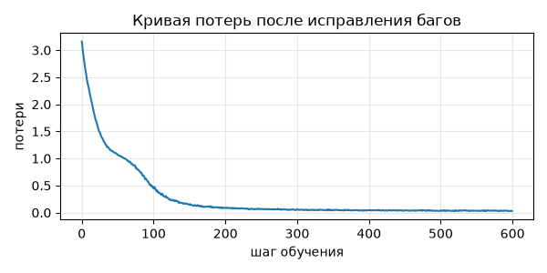

## Решение домашнего задания по реализации механизма внимания в трансформере и поиску семантических ошибок в готовом коде.

## Требования к окружению
Python: 3.10+
PyTorch: 2.0+
Среда выполнения: Google Colab (бесплатный тариф, ускоритель T4) или локальный запуск
Дополнительные библиотеки: matplotlib

## Установка зависимостей:
```
pip install torch matplotlib
```

## Ошибки в ноутбуке с багами
### Ошибка 1
Ошибка в функции sinusoidal_positional_encoding в строке 1
Позицонное кодирование начинается с 1, а не 0 как в оригинальной формуле, из-за этого теряется константный вектор начала последовательности.

Способ исправления: 
Заменить `torch.arange(1, length + 1, dtype=torch.float32)` на `torch.arange(length, dtype=torch.float32)`, чтобы позиции шли от 0 до L-1.

### Ошибка 2
Ошибка в методе forward для LayerNorm на строке 1 и 2
В исходном коде среднее и дисперсия считаются по оси батча. Это создает утечку данных при обучении, потому что нормализация одного токена начинает зависеть от других примеров в батче. А при инференсе предсказание идет по одному токену и получается, что дисперсия будет равна 0 и нормализованный вектор тоже будет равен 0. 

Способ исправления:
Заменить `dim=0` на `dim=-1` в обоих вызовах mean и var, чтобы статистика считалась по оси признаков внутри каждого токена отдельно.

### Ошибка 3
Ошибка в функции scaled_dot_product_attention в строке 5
Softmax берётся по оси запросов вместо оси ключей, из-за чего строки матрицы весов перестают быть распределениями и сумма по строке плавает. И при нормировке столбца суммируются все его значения, т.е. выход позции i начинает зависеть от позиций i+...

Способ исправления:
Заменить `dim=-2` на `dim=-1`, чтобы нормировка шла по ключам, каждая строка суммировалась в единицу, и будущие запросы не влияли на знаменатель прошлых позиций.

## Функция потерь


## Вывод 
ания смотрит на все позиции сразу. алгоритм внимания смотрит на все позиции сразу. алгоритм внимания смотрит на все позиции сразу. алгоритм внимания смотрит на все позиции сразу. алгоритм внимания смот